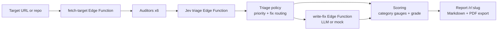

# Vibe-Code Auditor

Paste a deployed URL or a public GitHub repo and get a security & quality score card.
Deterministic auditors (secrets, headers, auth/Supabase RLS hints, accessibility, SEO,
performance) produce findings. **Jev** (TypeSafe AI's fast decision model) triages each
one by severity, exploitability, and false-positive likelihood, and picks which get an
LLM-written fix. Code scores, and results become a shareable report at `/r/:slug`.

**Rules find, Jev triages, code scores, the LLM writes fixes.**

## How it works



## Safety & scope

The scanner is **read-only and passive**. Hard rules, enforced server-side in `fetch-target`:

- Only `GET` requests for publicly served resources: the page, scripts/stylesheets it
  links (same origin plus up to 10 CDN files), source maps those files reference,
  `robots.txt`, `sitemap.xml`, and `/.well-known/security.txt`.
- Never submits forms, logs in, guesses paths (no `/.env` or `/.git` probing), fuzzes,
  brute-forces, port-scans, or sends attack payloads.
- **Never uses discovered credentials.** Found keys are never sent anywhere. A Supabase
  anon key is never used to query the target's database — RLS findings are hints from
  code and config only. JWTs are decoded locally (base64 only) to read the `role` claim.
- **Secrets are masked everywhere**: `sk-p…9xQ2` (first 4 + last 4 chars). Only the mask
  and a hash are stored — never the full value. LLM and Jev inputs see only masked evidence.
- **Limits & SSRF guard**: http/https only; blocks localhost, private/loopback/link-local/CGNAT,
  unique-local, IPv4-mapped IPv6, multicast and reserved ranges, `169.254.169.254`,
  `.internal`/`.local` and single-label hosts, and non-standard ports. Hostnames are resolved
  (A + AAAA) on every hop and rejected if any address is private or reserved, or if DNS fails.
  Redirects are followed manually (max 3) and re-checked at every hop. Each scan: max 30
  requests, 2 MB per file, 6 MB total, 20 s per request. URL mode requires a consent checkbox
  ("I own this app or have permission to audit it").
- **Daily cap**: every edge function call, and every paid upstream call (each Jev request and
  retry, each LLM fix), is counted against a per-function daily cap (default 200, set
  `DAILY_CALL_LIMIT` to change it). Over the cap the functions return 429; if the counter
  cannot be read they fail closed with 503.

## Why Jev triage?

Auditors are deliberately noisy — heuristics over-match, and example code looks like real
leaks. A per-finding judgment call is the perfect job for a fast, cheap model: every
finding gets severity, exploitability, placeholder probability, and a fix route in one
fan-out request. Priority math (`severity × exploitWeight × (1 − placeholder)`) and the
LLM-routing rule (`code_change` + confidence ≥ 0.6 + severity ≥ 2 + placeholder < 0.5,
capped at the top 8 by priority) live entirely in plain TypeScript, so the expensive LLM
only writes fixes for findings that deserve them. If Jev is unreachable, a rule-based
severity table takes over, labeled **"Fallback (not Jev)"**.

## Setup

```bash
supabase secrets set TYPESAFE_API_KEY=... OPENAI_API_KEY=... GITHUB_TOKEN=...
supabase functions deploy
npm install
npm run dev
```

Secrets are server-side only (edge function environment) — nothing sensitive is ever
bundled into the browser. Without `TYPESAFE_API_KEY` or `OPENAI_API_KEY` the app still
works: Jev falls back to the rule table and the fixer returns static templates
("Mock fixer" is also selectable in the UI; Jev still runs live in mock mode).

## Environment variables

| Variable | Where | Purpose |
|---|---|---|
| `TYPESAFE_API_KEY` | Edge Function secret | Jev triage via `api.typesafe.ai` (model `jev-1.13.0`, pinned) |
| `OPENAI_API_KEY` | Edge Function secret | LLM fix writing |
| `OPENAI_BASE_URL` | Edge Function secret (optional) | Alternate OpenAI-compatible endpoint |
| `OPENAI_MODEL` | Edge Function secret (optional) | Fixer model (default `gpt-6-luna`) |
| `GITHUB_TOKEN` | Edge Function secret (optional) | Raises GitHub API rate limits for repo mode |
| `DAILY_CALL_LIMIT` | Edge Function secret (optional) | Per-function daily call cap (default 200) |

## Demo fixtures (offline)

Three fixtures run entirely offline — "Load demo" runs the real audit, triage, and
scoring code on bundled files:

- **Leaky Todo** — a deployed app with a constructed synthetic scanner probe in the
  bundle, an unsigned synthetic service_role JWT with an invalid signature, no CSP, and exposed source maps.
- **Supabase Starter repo** — migrations missing RLS, a committed `.env`.
- **Well-configured site** — hardened headers, clean a11y/SEO; grade A.

With **Offline replay** on, recorded Jev responses are used instead of live calls.

## Screenshots


## Limitations

- Static analysis of fetched HTML/JS/config only — no JS execution, no rendering, so
  SPA content and runtime-injected attributes are invisible to the a11y/SEO auditors.
- RLS findings are **hints** parsed from migration text; always confirm in the Supabase
  dashboard. A public anon key on its own is info, not a vulnerability.
- This is not a penetration test: no exploitation, no payload delivery, no path guessing.
- Severity scores are model judgments (or fallback-table values), not ground truth.

## Design decisions

- **Deterministic auditors, model triage.** Regex/parsing rules are explainable and
  free; the model adds judgment without owning the scoring math, which stays in code.
- **Evidence is untrusted.** Target content is wrapped as data in Jev prompts, and any
  finding whose evidence contains instruction-like text is flagged and forced to a high
  placeholder probability.
- **Server-side secrets.** All provider keys live in the edge function environment;
  the browser only ever holds the Supabase anon key.
- **Single public workspace, no auth.** This is a demo product; scans are shared by slug
  through permissive anon policies on `scans`/`findings` (RLS enabled, no user data).
- **Cost transparency.** The report shows Jev's measured cost per scan next to an
  estimated LLM-triage cost, with editable constants.

Fixture credential probes are deliberately invalid and constructed locally for offline scanning. They are never used for authentication. The synthetic JWT has alg: none, a reserved .invalid issuer, and an invalid signature.

Run the isolated offline fixture regressions with Node 24+: npm run test:fixtures. They verify that invalid probes still reach the real OpenAI and service-role detectors without a network call.
